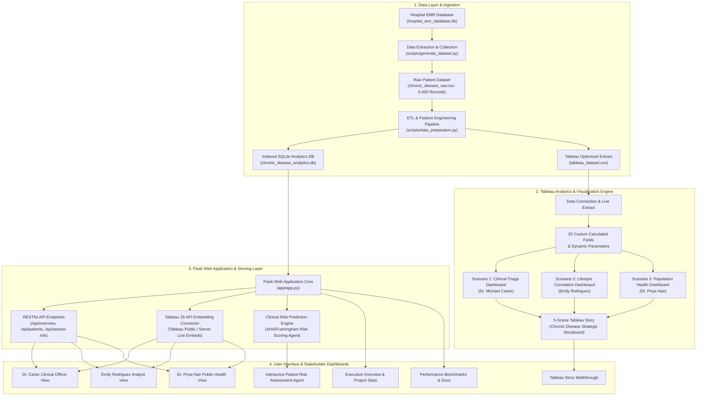

# Technical Architecture Specification

## 1. System Overview
The **Chronic Disease Health Risk Assessment and Patient Monitoring System** is an enterprise-grade medical analytics and clinical decision-support platform designed to address early detection challenges for chronic illnesses including **Coronary Heart Disease**, **Type 2 Diabetes Mellitus**, and **Cerebrovascular Stroke**.

The architecture combines a high-performance **Python/SQLite Data Engineering Pipeline**, a rich **Tableau Visualization Engine** (supporting 3 specialized scenario dashboards and a 5-scene clinical story), and an integrated **Flask Web Application** featuring an **Interactive Clinical Risk Assessment Agent**.

---

## 2. Technical Architecture Diagram

---

## 3. Component Architecture

### A. Data Layer
- **Storage**: SQLite 3 with B-Tree indexes on `risk_tier`, `age_group`, and combined disease diagnosis flags (`heart_disease`, `diabetes`, `stroke`).
- **Feature Engineering**:
  - Continuous-to-categorical binning (AHA Blood Pressure Stages, ADA Glycemic Tiers, WHO BMI Categories, NCEP ATP III Cholesterol Tiers).
  - Multi-factorial risk scoring incorporating hemodynamic, metabolic, lifestyle, and symptomatic markers.
  - Multi-morbidity count (co-occurrence of 0 to 4 chronic diseases).

### B. Tableau Visualization Engine
- **Workbook Structure**: `tableau/Chronic_Disease_Risk_Analysis.twb`
- **Dashboards**:
  1. *Clinical Risk Assessment & Triage* (Dr. Michael Carter): Early warning radar, urgent triage roster, blood pressure vs glucose risk matrix.
  2. *Lifestyle & Behavioral Correlation* (Emily Rodriguez): Smoking & alcohol heatmaps, physical activity protective gradients, diet vs metabolic syndrome.
  3. *Population Demographic Epidemiology* (Dr. Priya Nair): Demographic age-gender pyramids, BMI vulnerability distribution, symptom frequency matrices.
- **Story**: 5-Scene narrative guiding clinical leadership from population illness burden through actionable prevention.

### C. Web Application & AI Agent Layer
- **Framework**: Python Flask 3.x WSGI application.
- **Risk Assessment Agent**: Accepts live patient vitals via modal/form, executes multi-factorial clinical assessment algorithms, generates triage classification, calculates cardiovascular & stroke event risk, and delivers personalized clinical guidelines.
- **Hybrid Embed System**:
  - Live Tableau JavaScript API Embed (`tableau-viz` container) for Tableau Server / Tableau Public integration.
  - Native Chart.js interactive fallback dashboards ensuring full zero-dependency standalone execution.

---

## 4. System Requirements

### Hardware Requirements
- **Processor**: Intel Core i5 / AMD Ryzen 5 or higher (minimum 2.0 GHz)
- **RAM**: Minimum 8 GB (16 GB recommended for high-volume Tableau extracts)
- **Disk Storage**: 500 MB free disk space for dataset, database, and web application assets

### Software Requirements
- **Operating System**: Windows 10/11, macOS 12+, or Ubuntu 20.04+ LTS
- **Tableau**: Tableau Desktop 2022.1+ or Tableau Public (latest version)
- **Python**: Python 3.10, 3.11, or 3.12
- **Web Browser**: Google Chrome, Mozilla Firefox, Microsoft Edge, or Safari (modern evergreen browsers supporting ES6 and WebGL/Canvas)
